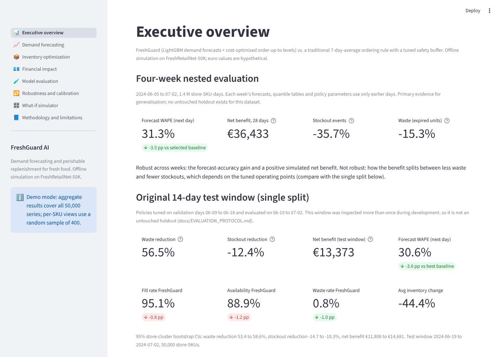
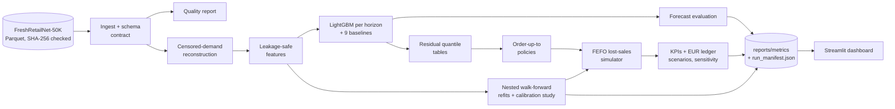
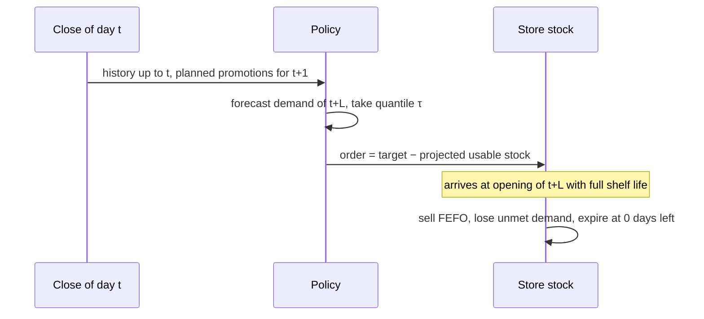
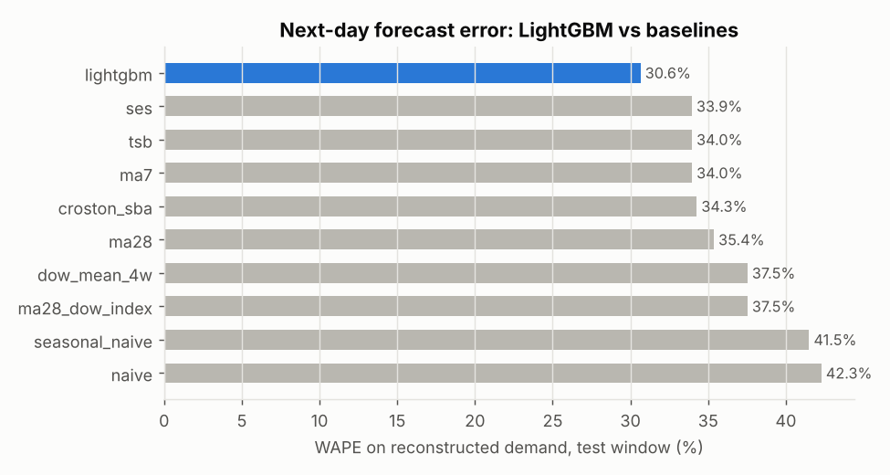
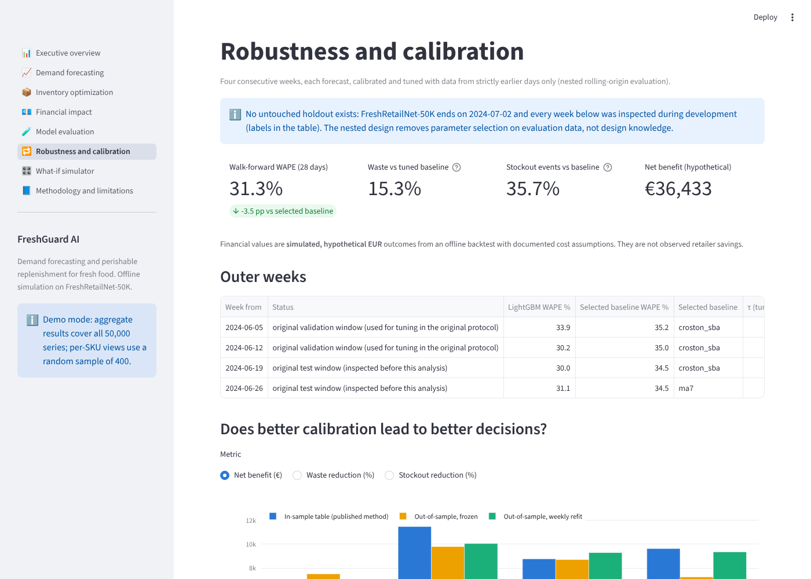
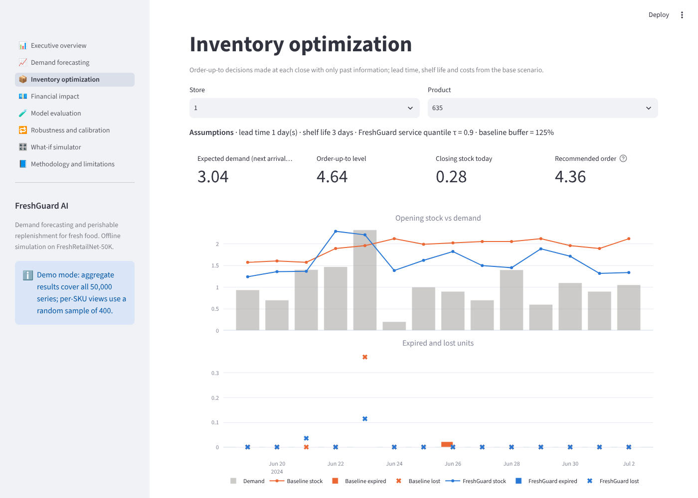
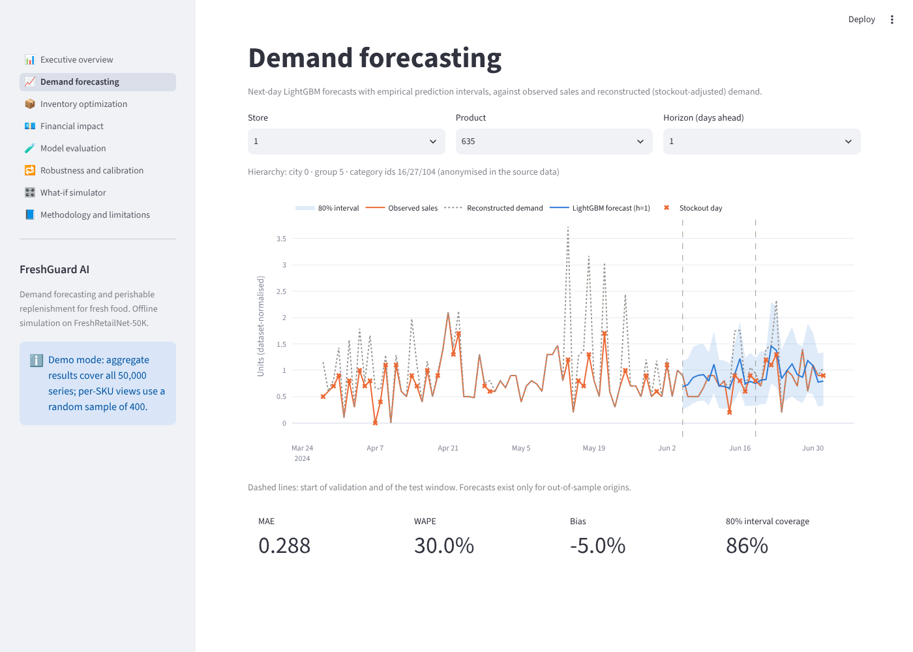
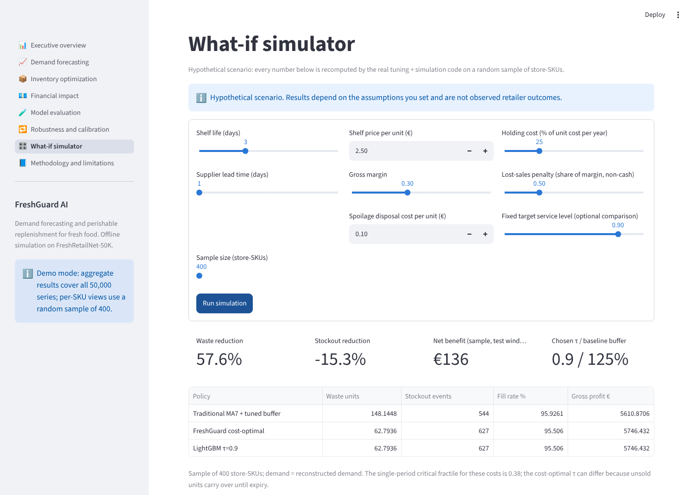

# FreshGuard AI

**Demand forecasting and perishable-inventory optimisation for fresh food, evaluated in an
offline simulation on 50,000 real store-SKU series.**

FreshGuard forecasts next-day demand for fresh products, corrects for demand hidden by
stockouts, turns forecasts into cost-aware replenishment orders, and measures in a
chronological simulation what that changes for waste, stockouts and (hypothetical) profit
compared with a tuned traditional ordering rule.

> **Scope.** An offline research study on the public FreshRetailNet-50K dataset. Inventory,
> waste and profit are **simulated**; euro amounts rest on documented **hypothetical** cost
> assumptions (the dataset has no prices). Nothing has been deployed. Demand on stockout days
> is **reconstructed**, not observed.



## Verified results

FreshRetailNet-50K, next-day ordering, 1-day lead time, 3-day shelf life, base cost scenario.
Primary evidence is the **nested rolling-origin evaluation**: four consecutive weeks, each
forecast, calibrated and tuned with earlier data only. No untouched holdout exists for this
dataset (every day was seen during development), see
[`docs/EVALUATION_PROTOCOL.md`](docs/EVALUATION_PROTOCOL.md).

| Result (vs a 7-day-average rule with a tuned safety buffer) | Nested, 4 weeks (06-05 .. 07-02) | Original single split (14 test days, inspected more than once) |
|---|---|---|
| Next-day WAPE, LightGBM vs best baseline | **31.3% vs 34.8%** (lower in 4 of 4 weeks) | 30.6% vs 34.3% |
| Simulated net benefit (hypothetical €) | **+€36.4k** over 28 days (95% CI 34.5k to 38.3k), positive in 4 of 4 weeks | +€13.4k over 14 days (CI 11.8k to 14.7k) |
| Stockout events | **−35.7%** | +12.4% (worse) |
| Expired units (waste) | **−15.3%** (but +18% in one of the 4 weeks) | −56.5% |

**How to read this.** The forecast-accuracy gain and a positive simulated net benefit hold in
every week and under both protocols. How the benefit splits between *less waste* and *fewer
stockouts* does **not**: it depends on where the profit-tuned operating points land in each
tuning window. CIs come from store-cluster bootstraps and describe uncertainty across stores,
not across future weeks. Source files: `reports/metrics/freshretailnet/` and
`reports/metrics/freshretailnet/nested/`.

## 1. Problem

Every evening a fresh-food manager decides how much to order for tomorrow. Order too much and
the surplus expires; order too little and shelves run empty. Demand is volatile at
store-product level, shelf lives are a few days, and sales data hides part of demand: when a
shelf is empty, recorded sales understate what customers wanted.

**Question:** how much waste, how many stockouts and how much money could a retailer change
with forecast-driven replenishment instead of a traditional ordering rule, and how sure can we
be?

## 2. Key technical capabilities

* **Censored-demand reconstruction** from hourly stockout flags (intraday-profile estimator,
  fitted on training days only).
* **Global LightGBM** forecaster (direct models for 1, 2, 3, 7 days ahead, 56 leakage-tested
  features) against **9 baselines** including Croston-SBA and TSB on identical rows.
* **Empirical predictive quantiles** (binned residual tables) and a profit-tuned
  **order-up-to policy**.
* **Vectorised FEFO lost-sales simulator** for 50,000 series with lead time, shelf life,
  capacity and asserted physical invariants; exact profit decomposition.
* **Nested rolling-origin evaluation** with weekly walk-forward refits, per-week policy tuning
  and a **calibration study** of rolling recalibration (negative result, documented).
* **Reproducibility tooling**: locked dependencies, dataset SHA-256 checks, per-stage run
  manifests, and `make reproduce`, which reruns everything in isolation and diffs it against
  the committed metrics.
* **Streamlit dashboard** (8 pages) that runs without the dataset using a versioned demo bundle.

## 3. Architecture



Data flow of one simulated day (identical for every policy):



Pipeline stages (`freshguard <stage>` or `make <stage>`): `data → eda → forecast → evaluate →
simulate → nested → report`. Each stage reads the previous stage's artifacts and appends its
provenance to `run_manifest.json`.

## 4. Dataset and limitations

**FreshRetailNet-50K** (Dingdong-Inc, [Hugging Face](https://huggingface.co/datasets/Dingdong-Inc/FreshRetailNet-50K),
[paper](https://arxiv.org/abs/2505.16319), CC BY 4.0): 50,000 store-product series of a fresh
e-grocery retailer (898 stores, 865 products, 18 cities), 97 days (2024-03-28 to 2024-07-02)
with hourly sales and **hourly stock status**, discounts, activity and holiday flags, weather.
Dataset choice: [`docs/data_selection.md`](docs/data_selection.md).

| Observed in the data | Reconstructed | Assumed (scenario parameters) |
|---|---|---|
| Daily and hourly sales, hourly stockout flags, discounts, activity and holiday flags, weather, anonymised ids | Demand on the 44% of store-SKU-days with stockout hours (+26% total units) | Prices and costs (EUR), shelf life 3 days, lead time 1 day, capacity, disposal, holding and goodwill costs |

Categories are anonymised ids, so nothing is labelled fruit, meat or bakery. Units are
normalised by the publisher. The history is short and covers one season.

## 5. Forecasting methodology

* **Target**: reconstructed demand of day t + h, forecast at the close of day t; h = 1 is
  primary (1-day lead time).
* **Model**: global LightGBM, tweedie loss, one direct model per horizon. Features: lags,
  rolling statistics, same-weekday history, intermittency, stockout history, promotions,
  calendar, hierarchy ids. Target-day inputs are limited to calendar fields and planned
  discount/activity flags; a future-perturbation test enforces this.
* **Baselines**: naive, seasonal naive, MA7, MA28, 4-week weekday mean, MA28 × weekday index,
  SES, Croston-SBA, TSB.
* **Not used, deliberately**: deep learning (97 days, CPU budget), other GBM libraries (no
  expected gain), reinforcement learning (no justification over tuned base-stock policies).

Details: [`docs/methodology.md`](docs/methodology.md).

## 6. Inventory optimisation methodology

Each policy sets an **order-up-to level** S for the delivery day; the order is
`max(0, S − projected usable stock)`, where the projection removes units that will expire
first. Traditional policies use observed sales, like a store without stockout-aware analytics.
FreshGuard sets S at the τ-quantile of forecast demand and tunes τ **by simulated profit** on
the days before evaluation. The single-period newsvendor fractile (τ = 0.38 here) ignores that
unsold units carry over for up to 3 days; it is evaluated and loses €140.6k against the
baseline.

## 7. Evaluation and validation

* **Original protocol** (kept unchanged): train ≤ 06-04, validation 06-05..06-18 for all
  selection, test 06-19..07-02 in two expanding-window refits. Audit finding: the test window
  was inspected more than once (the baseline's buffer grid was widened and an equal-availability
  comparison was added after the first run), so it is reported as *inspected*, not untouched.
* **Nested rolling-origin evaluation** (new): weekly walk-forward refits with pre-specified
  hyperparameters; for each of four outer weeks, baseline selection, quantile tables, the
  baseline's buffer and FreshGuard's τ use only earlier days.
* **Leakage and contamination audit** of every selection step:
  [`docs/EVALUATION_PROTOCOL.md`](docs/EVALUATION_PROTOCOL.md).
* **Calibration study**: the 0.9 quantile covers 88.6% of outcomes; coverage is 96% on
  fully-in-stock days but 78% on stockout days, where the target is reconstructed. Rolling
  recalibration did not improve coverage or profit, so the published method was kept:
  [`docs/CALIBRATION_STUDY.md`](docs/CALIBRATION_STUDY.md).

### Detailed single-split results (original protocol, 14 test days)

| KPI | Traditional (tuned, +125% buffer) | FreshGuard (τ = 0.9) | Change |
|---|---|---|---|
| Expired units (waste) | 17,928 | 7,798 | −56.5% (CI −53.4 to −58.6%) |
| Stockout events | 68,904 | 77,438 | +12.4% (worse) |
| Unit fill rate | 95.9% | 95.1% | −0.8 pp |
| Gross profit (hypothetical €) | 682,735 | 696,108 | +€13,373 (+2.0%) |



* A fixed LightGBM policy with 95% normal safety stock reduced waste by 15.6% *and* stockouts
  by 37.7% (+€16.2k).
* A 7-day average of *reconstructed* demand without ML gains +€11.5k: a large part of the value
  comes from correcting censored demand.
* Interpolating the LightGBM frontier at the baseline's test availability gives −49% waste and
  +€14.5k; this is an **oracle** operating point read off the test window, not an achievable
  result.

| Sensitivity (base economics, re-tuned each time) | Waste | Stockouts | Net benefit |
|---|---|---|---|
| Shelf life 1 / 3 / 7 days | −48 / −57 / −33% | +20 / +12 / +4% | +€49.8k / +€13.4k / +€0.4k |
| Lead time 1 / 2 / 3 days | −57 / −50 / −46% | +12 / +6 / +2% | +€13.4k / +€18.0k / +€21.5k |
| Demand = observed sales (no lost demand at all) | −29% | +65% | **−€3.9k** |
| Unforecastable noise σ = 0.5 | −43% | +6% | **−€1.0k** |

The value disappears if stockout-censored demand is assumed not to exist or if demand is much
noisier than its history suggests. Full tables: `reports/metrics/freshretailnet/sensitivity.csv`.

Secondary benchmark on M5 FOODS (no stock data): LightGBM did not beat the best baseline
(WAPE 53.4% vs 53.2%), see [`docs/m5_benchmark.md`](docs/m5_benchmark.md).

## 8. Interactive demo

`make dashboard` starts an eight-page Streamlit app: executive overview, demand forecasting,
inventory optimisation, financial impact, model evaluation, robustness and calibration,
what-if simulator, methodology and limitations. Every number is read from pipeline outputs,
and the what-if page reruns the real tuning and simulation code.

Without the dataset (fresh clone or hosted), the app runs in **demo mode**: aggregate pages use
the committed metrics for all 50,000 series, and per-SKU pages use a versioned random sample
of 400 series (`demo/freshretailnet/`). Deployment on Streamlit Community Cloud is prepared but
not yet live: [`docs/DEMO_DEPLOYMENT.md`](docs/DEMO_DEPLOYMENT.md).

| | |
|---|---|
|  |  |
|  |  |

## 9. Installation and quick start

Python 3.11+ (results produced on 3.13), CPU only, about 16 GB RAM for the full dataset.

```bash
git clone https://github.com/eirinitzortzidou/freshguard-ai && cd freshguard-ai
make setup          # .venv with the exact locked versions (requirements/lock.txt)
make check          # lint + type check + 54 tests on synthetic data (no download)
make dashboard      # demo mode works immediately: http://localhost:8501
```

Full experiment (downloads FreshRetailNet-50K from Hugging Face, or copy `train.parquet` and
`eval.parquet` into `data/raw/freshretailnet/`):

```bash
make all            # data -> eda -> forecast -> evaluate -> simulate -> nested -> report
make smoke          # same pipeline on the synthetic fixture (under a minute)
freshguard simulate --config configs/freshretailnet.yaml   # any single stage
make all CONFIG=configs/m5.yaml                            # secondary benchmark
```

## 10. Reproducibility

```bash
make reproduce      # isolated rerun in runs/reproduce/, then a value-by-value diff
```

`make reproduce` copies the configs, links the raw data, reruns every stage without touching
committed results, and writes `runs/reproduce/comparison.md`. Each stage records git commit,
dataset SHA-256, package versions, seed, resolved config, platform, timestamps and output
hashes in `run_manifest.json`. A clean rerun on 2026-10-22 reproduced all published forecast
and simulation metrics; 13 of about 47,000 values differ by at most 2 × 10⁻⁶ (relative) because
of float32 summation order. Details: [`docs/REPRODUCIBILITY_REPORT.md`](docs/REPRODUCIBILITY_REPORT.md).

## 11. Repository structure

```
configs/            base.yaml + freshretailnet.yaml (primary, with dataset checksums), m5.yaml, synthetic.yaml
src/freshguard/
  data/             ingestion, schema, validation, demand reconstruction, M5 loader, synthetic fixture
  features/         rectangular panel arrays, leakage-safe feature builder
  forecasting/      baselines, LightGBM wrapper (save/load), quantile tables, rolling-origin backtest
  evaluation/       metrics, segment + bootstrap evaluation, nested evaluation and calibration study
  inventory/        policies, FEFO simulator, tuning and experiments
  finance/          KPI ledger, EUR accounting, scenario comparison, bootstrap
  visualization/    EDA, report and nested-evaluation figures
  provenance.py     checksums and run manifests;  verify.py  rerun-vs-published comparison
  pipeline.py, cli.py
dashboard/          Streamlit app (app.py, data.py, views/)
demo/               versioned 400-series sample for the hosted dashboard
scripts/            reproduce.py, build_demo_bundle.py, capture_dashboard.py
tests/              54 tests (unit, leakage, simulator invariants, nested protocol, smoke)
reports/            metrics/ (JSON/CSV), figures/, EDA and data-quality reports, reproducibility/
docs/               methodology, evaluation protocol, calibration study, reproducibility,
                    deployment, audit, final review, data selection, research review, M5
requirements/       lock.txt (exact versions);  requirements.txt for hosted deployment
```

## 12. Engineering quality and tests

`make check` runs Ruff, mypy and 54 pytest tests on synthetic data: schema contracts, panel
construction, demand reconstruction against known truth, lag and rolling correctness,
**future-perturbation leakage tests**, baseline alignment, quantile coverage, deterministic
GBM output and model save/load round-trip, simulator conservation, expiry timing, FEFO, exact
lead times, pack and capacity constraints, hand-calculated P&L, exact profit decomposition,
**calibration tables that ignore unknown outcomes**, checksum verification, run manifests, the
rerun comparison tool, and a full end-to-end pipeline run including the nested stage. GitHub
Actions runs the locked environment (Python 3.13) and the newest allowed versions on
Python 3.11.

## 13. Limitations and future work

* Simulated, not deployed; euro values are hypothetical.
* Reconstructed demand is an estimate; results reverse if no demand is lost at stockouts, and
  calibration is poor on stockout days.
* 97 days, one season, four evaluation weeks; no untouched holdout exists. A genuine holdout
  needs new data from the same retailer.
* Uniform shelf life, lead time and costs (anonymised categories); continuous order
  quantities; no substitution, supplier minimums or shelf-space limits.

Future work: calibration that accounts for censoring (censored likelihood, residual tables
conditioned on stockout-risk features), drift-aware bias correction, category-specific
parameters once product attributes exist, and a shadow-mode pilot against real orders.

## 14. License and acknowledgements

Code: MIT licence. Data: FreshRetailNet-50K by Dingdong-Inc, CC BY 4.0; raw data is not
redistributed, and `demo/` contains a small derived sample with attribution
([`demo/README.md`](demo/README.md)). Key references: Wang et al. (2025) FreshRetailNet-50K;
Makridakis et al. (2022) M5; Ke et al. (2017) LightGBM; Croston (1972); Syntetos & Boylan
(2005); Nahmias (1982); Angelopoulos & Bates (2021); full list in
[`docs/research_review.md`](docs/research_review.md#5-references).
