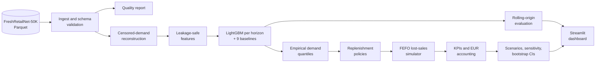
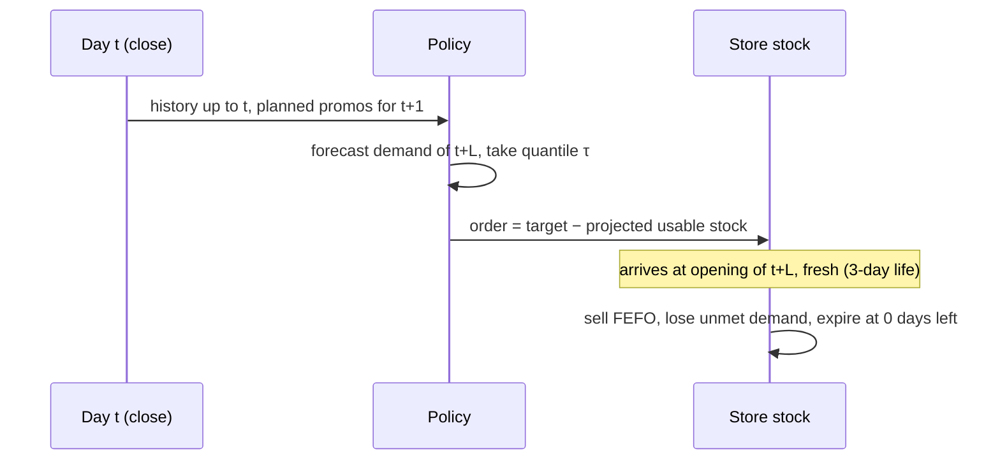
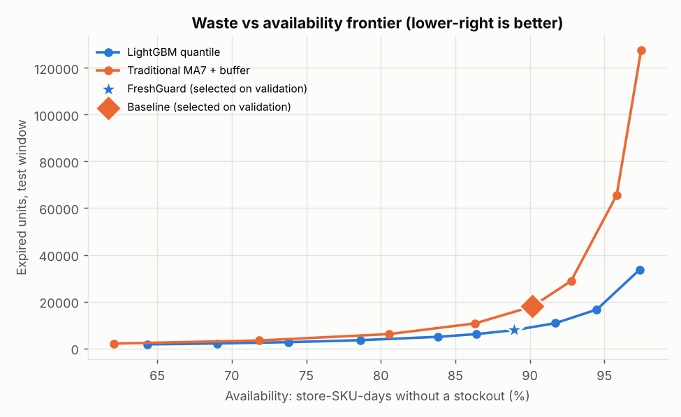
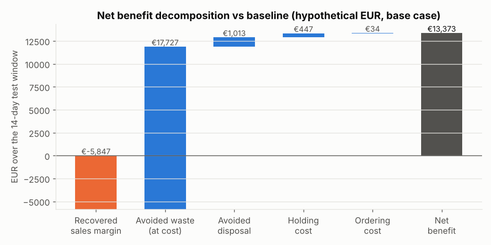
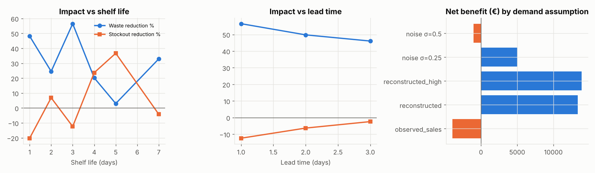
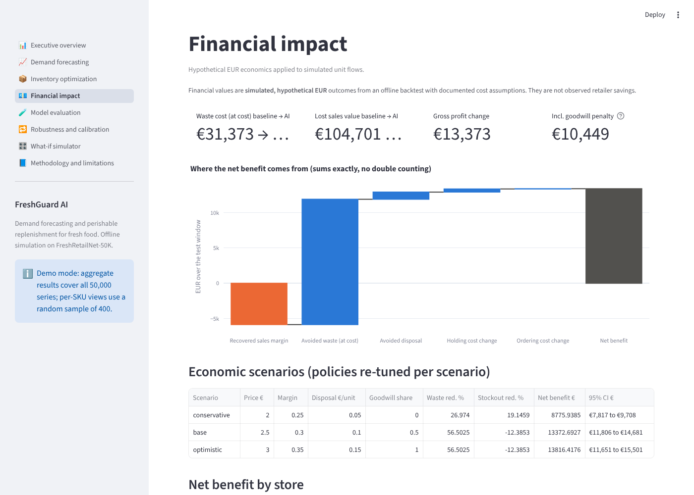

# FreshGuard AI

**Reducing fresh food waste through demand forecasting and inventory optimisation.**

FreshGuard forecasts next-day demand for 50,000 fresh-food store-SKUs. It corrects for
demand hidden by stockouts and turns the forecasts into cost-aware replenishment orders. It
then measures, in a chronological simulation, how much waste, how many stockouts and how
much money that changes compared with traditional ordering rules.

> **Status:** complete offline study on FreshRetailNet-50K. All results below come from an
> out-of-sample backtest and simulation (`make all`). Euro amounts are **hypothetical**: the
> dataset has no prices or costs, so they rest on documented scenario assumptions. They are not
> observed retailer savings, and the system has not been deployed.


---

## 1. Business problem

Every evening a fresh-food manager decides how much bread, fruit or meat to order for tomorrow.
Order too much and the surplus expires; order too little and customers find empty shelves.
Daily, product-level demand is volatile, shelf lives are a few days, and sales data hides
part of demand: when a shelf is empty, sales are zero even if customers wanted to buy.

**Primary question:** how much waste, how many stockouts and how much money could a supermarket
save with machine-learning-driven replenishment instead of traditional ordering rules?

## 2. Why food waste matters

UNEP's *Food Waste Index Report 2024* estimates about 1.05 billion tonnes of food waste in 2022,
part of it at retail. For a grocer, fresh categories combine high spoilage risk with the
largest availability expectations. Waste is lost purchase cost plus disposal cost, and
stockouts are lost margin plus lost customer goodwill.

## 3. Objectives

1. Forecast store-SKU demand without information leakage and beat strong simple baselines.
2. Treat stockout-censored sales explicitly, so that empty shelves don't read as low demand.
3. Convert forecasts into order quantities that respect lead time, shelf life and costs.
4. Measure waste, stockouts, service and profit against traditional policies under identical
   conditions, with uncertainty intervals and sensitivity analysis.
5. Package the work as a reproducible, tested, documented project with a decision-support dashboard.

## 4. Dataset and limitations

**FreshRetailNet-50K** (Dingdong-Inc, [Hugging Face](https://huggingface.co/datasets/Dingdong-Inc/FreshRetailNet-50K),
[paper](https://arxiv.org/abs/2505.16319), CC BY 4.0): 50,000 store-product series of a
fresh e-grocery retailer (898 stores, 865 products, 18 cities). It has 90 training days plus
the official 7-day evaluation week (2024-03-28 to 2024-07-02), with hourly sales and **hourly
stock status**, discounts, activity and holiday flags, and weather.
Full comparison with Favorita and M5: [`docs/data_selection.md`](docs/data_selection.md).

| Real (in the data) | Assumed (scenario) |
|---|---|
| Daily and hourly sales, hourly stockout flags, discounts, activity and holiday flags, weather, anonymised ids | Prices and costs (EUR), shelf life (3 days), lead time (1 day), capacity, disposal, holding and goodwill costs |

Limitations: categories are anonymised ids, so **nothing is labelled fruit, vegetables, meat
or bakery**. Units are normalised by the publisher. The history is short (97 days). There is
no inventory, delivery or waste data, so these are simulated. Demand on stockout days is
estimated, not observed.

## 5. System architecture





## 6. Modelling approach

* **Demand reconstruction.** An intraday demand profile per series (from fully in-stock
  training days) estimates the share of daily demand that fell into out-of-stock hours.
  Censored days are scaled up, with a fallback for near-full-day stockouts. This adds +26.1% to
  total units. Details: [`docs/methodology.md`](docs/methodology.md#2-censored-demand-reconstruction).
* **Forecasting.** A global LightGBM model (tweedie loss), one direct model per horizon (1, 2,
  3, 7 days), with 56 features: lags, rolling statistics, same-weekday history, intermittency,
  stockout history, promotions, calendar, and hierarchy ids. Only target-day features known
  when ordering are used (planned discount and activity, calendar). Leakage is unit-tested.
* **Baselines.** Naive, seasonal naive, MA7, MA28, 4-week weekday mean, MA28 × weekday index,
  SES, Croston-SBA and TSB, all evaluated on identical rows.
* **Not used, deliberately.** Deep learning (97 days of history, CPU budget, LightGBM
  dominance in M5), CatBoost/XGBoost (no expected gain), and reinforcement learning (no
  justification over tuned base-stock policies).

## 7. Inventory optimisation

Each policy sets an **order-up-to level** S for the delivery day, and the order is
`max(0, S − projected usable stock)`. The projection removes units that will expire before
the delivery is used. Traditional policies use observed sales, like a store without
stockout-aware analytics. FreshGuard sets S at the τ-quantile of forecast demand, using
binned validation residuals (a split-conformal style approach). τ is tuned **by simulated
profit on the validation window**, because the single-period newsvendor fractile
Cu/(Cu+Co) = 0.38 ignores that unsold units carry over for up to 3 days. The single-period
version is also evaluated, and it fails badly.

## 8. Evaluation methodology

* Chronological splits: train until 06-04, **validation** 06-05 to 06-18 (all tuning and
  selection), **test** 06-19 to 07-02 in two expanding-window refit folds. The second fold is
  the official FreshRetailNet eval week. The test window was used once, after selection was frozen.
* Forecasts: MAE, RMSE, WAPE (zero-safe) and bias, overall and by volume class, demand class,
  store, category and SKU. The FreshRetailNet protocol (observed sales on fully in-stock days)
  is reported as a check. Uncertainty comes from a store-cluster paired bootstrap.
* Simulation: all policies share the same demand, prices, costs, lead time, shelf life, capacity
  and initial stock. Seven warm-up days are excluded. A **stockout event** is a store-SKU-day
  with lost demand above 0.05 units. Profit differences decompose exactly into their drivers,
  so nothing is double-counted.

## 9. Results

### Forecast accuracy (test window, next day, 700,000 store-SKU-days)

| Method | WAPE | MAE | Bias |
|---|---|---|---|
| **LightGBM** | **30.6%** | **0.445** | −6.6% |
| SES (α = 0.1) | 33.9% | 0.493 | −5.9% |
| Moving average 7d | 34.0% | 0.493 | −2.3% |
| Croston-SBA (best baseline on validation) | 34.3% | 0.497 | −10.5% |
| Seasonal naive | 41.5% | 0.602 | −4.8% |

LightGBM lowers WAPE by **3.6 pp** against the validation-selected baseline (95% CI 3.4-3.9 pp).
It is better on **14 of 14** test days, in **97%** of stores and for **69%** of SKUs. On uncensored
days against observed sales it scores 30.1% vs 32.8%. Error grows with horizon (h = 1/2/3/7:
30.6 / 31.5 / 32.1 / 34.0%). All models under-forecast the late-June demand surge.


### Business impact (base case, 14 test days, 50,000 store-SKUs)

The baseline is the traditional 7-day sales average with its safety buffer **tuned on
validation** (+125%). This is a deliberately strong baseline: the common "+20%" rule loses
€89k against it.

| KPI | Traditional (tuned) | FreshGuard | Change | 95% CI (store bootstrap) |
|---|---|---|---|---|
| Expired units (waste) | 17,928 | 7,798 | **−56.5%** | −53.4 to −58.6% |
| Waste rate (expired / received) | 1.79% | 0.80% | −1.0 pp | |
| Stockout events | 68,904 | 77,438 | **+12.4% (worse)** | +10.3 to +14.7% |
| Availability (days without stockout) | 90.2% | 88.9% | −1.2 pp | |
| Unit fill rate | 95.9% | 95.1% | −0.8 pp | −0.6 to −0.9 pp |
| Lost demand (units) | 41,880 | 49,677 | +18.6% | |
| Average stock (units per SKU) | 1.20 | 0.67 | −44.4% | |
| Gross profit (hypothetical €) | 682,735 | 696,108 | **+€13,373 (+2.0%)** | +€11,806 to +€14,681 |

**Reading the trade-off honestly.** The profit-optimal setting chosen on validation (τ = 0.9)
halves waste and inventory but causes 12% more stockout events on the test window. Demand rose
faster than forecast in late June: forecast bias was −6.6%, and the τ = 0.9 quantile covered
only 87.5% of outcomes. FreshGuard therefore does **not** dominate the baseline at the selected
point. The **whole frontier does**, though: at the baseline's exact availability (90.2%), the
LightGBM policy wastes **49% fewer units** and earns about **€14.5k more**. A pre-defined fixed
policy, LightGBM with 95% normal safety stock, reduced waste by 15.6% *and* stockouts by 37.7%
(+€16.2k). Selecting τ on 10 validation days is the weakest link.



Where the net benefit comes from (exact decomposition, base case): avoided waste at cost
+€17.7k, avoided disposal +€1.0k, lower holding cost +€0.4k, ordering +€0.03k, and lost margin
on extra stockouts −€5.8k.



**Ablation.** A 7-day average of *reconstructed* demand (no ML) already gains +€11.5k
(waste −21.7%, stockouts −7.4%). A large part of the value comes from correcting
censored demand. LightGBM's sharper forecasts are what allow the large waste cut.

### Economic scenarios (policies re-tuned per scenario)

| Scenario | Price / margin / disposal / goodwill | Waste | Stockouts | Net benefit (95% CI) |
|---|---|---|---|---|
| Conservative | €2.00 / 25% / €0.05 / 0 | −27.0% | −19.1% | +€8,776 (7,817-9,708) |
| Base | €2.50 / 30% / €0.10 / 0.5 × margin | −56.5% | +12.4% | +€13,373 (11,806-14,681) |
| Optimistic | €3.00 / 35% / €0.15 / 1.0 × margin | −56.5% | +12.4% | +€13,816 (11,651-15,501) |

In the conservative scenario, re-tuning picks a lower baseline buffer (+100%), and FreshGuard
then improves **both** waste and stockouts.

### Sensitivity (base economics, re-tuned each time)

| Setting | Waste | Stockouts | Net benefit |
|---|---|---|---|
| Shelf life 1 / 2 / 3 / 4 / 5 / 7 days | −48 / −25 / −57 / −20 / −3 / −33% | +20 / −7 / +12 / −24 / −37 / +4% | +€49.8k / +€19.3k / +€13.4k / +€6.0k / +€4.0k / +€0.4k |
| Lead time 1 / 2 / 3 days | −57 / −50 / −46% | +12 / +6 / +2% | +€13.4k / +€18.0k / +€21.5k |
| Demand = observed sales (no lost demand at all) | −29% | +65% | **−€3.9k** |
| Demand = 1.5 × estimated lost demand | −41% | −7% | +€13.9k |
| Unforecastable noise σ = 0.25 / 0.5 | −26 / −43% | −12 / +6% | +€5.1k / **−€1.0k** |

The value is largest for short shelf lives and long lead times, where forecasting matters
most. It disappears if stockout-censored demand is assumed not to exist, or if demand is far
noisier than the history suggests. Both are reported as negative results.



Across 898 stores, 90% see a positive net benefit and 98% see less waste; stockouts fall in
38% of stores. By category id, 94% of 32 ids gain
([`impact_by_first_category_id.csv`](reports/metrics/freshretailnet/impact_by_first_category_id.csv)).

### Scale and annualisation

+€13.4k over 14 days and 898 stores is about **€1.06 per store per day** on this assortment
(56 SKUs per store), or 2.0% of simulated gross profit. A linear extrapolation to a year
(~€349k for these 50,000 store-SKUs) is shown only for orientation. It assumes the same
assumptions and demand regime for a whole year, which this 97-day dataset cannot support.

### Secondary benchmark: M5 FOODS

The same pipeline was run on 13,760 Walmart FOODS store-items, which have no stock data (stockouts
inferred). There, LightGBM did **not** beat the best baseline on test WAPE (53.4% vs 53.2% for TSB).
In simulation the policy still cut waste by 11.2% and stockout events by 27.7% against a tuned MA7
rule (+€41.8k over 28 days, assumed costs). Details: [`docs/m5_benchmark.md`](docs/m5_benchmark.md).

## 10. Dashboard

`make dashboard` opens a six-page Streamlit app. All values are read from pipeline artifacts,
and the what-if page reruns the real tuning and simulation code.

| | |
|---|---|
|  |  |
|  |  |

## 11. Installation and reproduction

Python 3.11+, CPU only. The full run takes about 35 minutes on 4 cores / 16 GB RAM
(the forecast stage takes about 16 minutes).

```bash
git clone https://github.com/eirinitzortzidou/freshguard-ai && cd freshguard-ai
make setup                       # .venv + editable install with dev tools
# Data: automatic download (needs huggingface.co) or manual copy, see docs/data_selection.md
make all                         # data -> eda -> forecast -> evaluate -> simulate -> report
make dashboard                   # http://localhost:8501
make test                        # unit + integration tests (synthetic fixture, no download)
make smoke                       # minimal end-to-end pipeline on synthetic data
make all CONFIG=configs/m5.yaml  # secondary benchmark on M5 FOODS
```

Individual stages: `make data | eda | forecast | evaluate | simulate | report`. Every stage
reads the previous stage's artifacts. Seeds are fixed and LightGBM runs in deterministic mode.

## 12. Repository structure

```
configs/            base.yaml + freshretailnet.yaml (primary), m5.yaml, synthetic.yaml (CI)
src/freshguard/
  data/             ingestion, schema, validation, demand reconstruction, M5 loader, synthetic fixture
  features/         rectangular panel arrays, leakage-safe feature builder
  forecasting/      baselines, LightGBM wrapper, empirical quantiles, rolling-origin backtest
  evaluation/       metrics, segment and bootstrap evaluation
  inventory/        policies, FEFO simulator, tuning and experiments
  finance/          KPI ledger, EUR accounting, scenario comparison, bootstrap
  visualization/    EDA and report figures
  pipeline.py, cli.py
dashboard/          Streamlit app (app.py, views/)
tests/              42 tests: schema, features, leakage, models, simulator, finance, smoke
reports/            eda_report.md, data_quality.md, figures/, metrics/ (JSON/CSV results)
docs/               data selection, research review, methodology, M5 benchmark
```

## 13. Technology stack

Python 3.11 · Polars · NumPy · PyArrow · LightGBM · SciPy · Matplotlib · Plotly · Streamlit ·
pytest · Ruff · mypy · GitHub Actions. No GPU, database or cloud service is required.

## 14. Testing

`make test` runs 42 tests on synthetic data, including:
schema validation, panel construction, quality checks, demand reconstruction
against known truth, lag and rolling correctness, **future-perturbation leakage tests**,
baseline alignment, quantile coverage, non-negative deterministic GBM output, simulator
conservation, expiry timing, FEFO, exact lead times, pack and capacity constraints, newsvendor
ratio, hand-calculated P&L, exact profit decomposition, currency conversion, reproducibility,
dashboard imports, and a full end-to-end pipeline run. CI runs lint, type checks, imports
and tests on every push, without downloading any dataset.

## 15. Key findings

1. **Censoring is the first-order problem.** 44% of store-SKU-days have stockout hours, and an
   estimated 21% of demand went unserved. Ordering from sales alone under-orders.
2. **LightGBM beats every baseline** on every test day (WAPE 30.6% vs 34-42%), but it
   under-forecasts a growing market.
3. **Forecast-driven replenishment dominates the traditional frontier.** At equal availability
   it wastes about 49% fewer units and earns more.
4. **Choosing the operating point is a business decision.** The profit-optimal point traded
   availability for waste on the test window, and a 95%-service policy improved both. The
   dashboard makes this choice explicit.
5. **The textbook newsvendor fractile is wrong for multi-day shelf life.** τ = 0.38 cut profit by
   €140.6k against the baseline.

## 16. Limitations

* Simulated, not deployed. Inventory, deliveries and waste are simulated, and all EUR values
  are hypothetical.
* Reconstructed demand is an estimate. The results flip sign if no demand is lost at stockouts.
* Uniform shelf life, lead time and costs for all SKUs; no per-category parameters (ids are
  anonymised).
* Short history (97 days), a single 14-day test window, and τ tuned on 10 days. Drift between
  validation and test is visible.
* Continuous order quantities (pack sizes implemented but unknown); no supplier minimums,
  shelf-space or labour constraints; no substitution between products.

## 17. Future improvements

* Drift-aware recalibration of quantiles (rolling conformal) to fix under-coverage in growth periods.
* Category-specific shelf lives and costs once real product attributes are available.
* Hierarchical reconciliation and probabilistic models (quantile LightGBM) for multi-day orders.
* Joint estimation of demand and stockouts (a censored-likelihood model) instead of two-stage reconstruction.
* A shadow-mode pilot comparing recommendations with actual orders before any live use.

## 18. References

Key references are listed in [`docs/research_review.md`](docs/research_review.md#5-references), including
Wang et al. (2025) FreshRetailNet-50K; Makridakis et al. (2022) M5; Ke et al. (2017) LightGBM;
Croston (1972); Syntetos & Boylan (2005); Nahmias (1982, 1994); Bijvank & Vis (2011);
Huh et al. (2009); Broekmeulen & van Donselaar (2009); Ban & Rudin (2019); Hyndman &
Koehler (2006); Angelopoulos & Bates (2021).

---

Data: FreshRetailNet-50K by Dingdong-Inc, CC BY 4.0 (not redistributed). Code: MIT licence.
