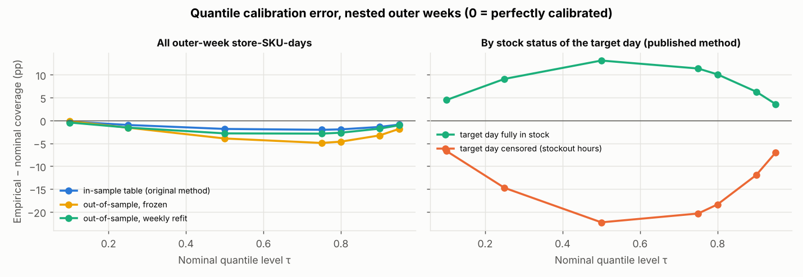
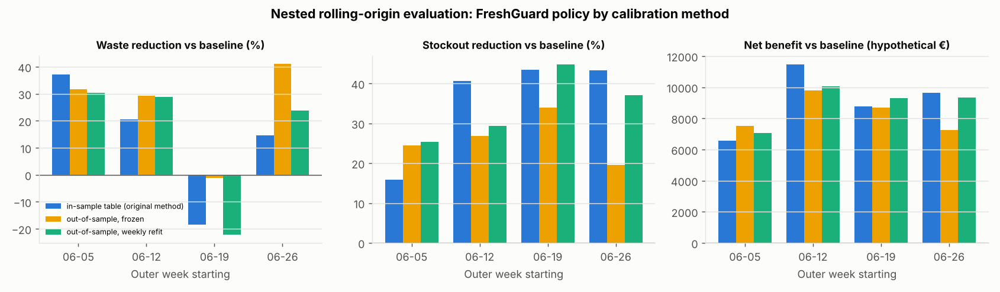

# Calibration study: rolling quantile recalibration

**Question.** The published test results showed quantile under-coverage (the 0.9 quantile
covered 87.5% of test outcomes) and a negative forecast bias in late June. Does a leakage-safe
rolling recalibration of the predictive quantiles fix this, and does it improve replenishment
decisions?

**Answer.** No robust improvement. Out-of-sample recalibration did not improve coverage or
pinball loss over the published method and lowered simulated profit slightly. The existing
approach is retained. The under-coverage is mainly a property of **stockout-censored target
days**, which no residual recalibration fixes. This is reported as a negative result.

Code: `src/freshguard/evaluation/nested.py` (`calibrators`, `rolling_tables`,
`coverage_table`, `horizon_calibration`), `src/freshguard/forecasting/intervals.py`
(`RollingQuantiles`). Outputs: `reports/metrics/freshretailnet/nested/`
(`calibration_coverage.csv`, `horizon_calibration.csv`, `nested_results.json`), figures 16-18 in
`reports/figures/freshretailnet/`. Tests: `tests/test_nested.py`.

## 1. What existed before

The project already had a calibration step: binned empirical residual quantiles
(`ResidualQuantiles`, 12 forecast-level bins, a Mondrian split-conformal style method). The
table is fitted once on validation residuals and never updated. The validation model's number
of boosting rounds was chosen on those same validation days, so the residuals could be
optimistic (audit item M2).

## 2. Methods compared

All three are evaluated inside the nested rolling-origin protocol
([`EVALUATION_PROTOCOL.md`](EVALUATION_PROTOCOL.md)) on the same walk-forward forecasts, on
four outer weeks (06-05 to 07-02, 1.4 M store-SKU-days):

| Method | Residuals used for the table applied to week *s* | Leakage-safe? |
|---|---|---|
| `insample` (published method) | the week's own model on its early-stopping window (7 days before *s*), in-sample to the choice of boosting rounds | yes, only days before *s* |
| `static` | first 14 days of out-of-sample walk-forward residuals (05-08 .. 05-21), then frozen | yes |
| `rolling` | the latest 14 days of out-of-sample residuals whose outcomes are known when week *s* is forecast (targets up to *s* − h) | yes; unit-tested by perturbing all later outcomes |

The simplest defensible options were chosen: no new model, the same 12-bin table, only the
residual window changes. Forecast-level bins are already a form of group-aware calibration.
Conformal guarantees require exchangeability, which demand drift in late June violates, so the
tables are treated as empirical quantiles, not as guaranteed intervals.

## 3. Statistical calibration

### 3.1 Coverage and pinball loss (all outer-week store-SKU-days)

| Nominal τ | 0.10 | 0.25 | 0.50 | 0.75 | 0.80 | 0.90 | 0.95 | Mean pinball loss (τ = 0.05..0.95) |
|---|---|---|---|---|---|---|---|---|
| `insample` (published) | 9.8% | 24.0% | 48.2% | 73.0% | 78.1% | **88.6%** | 94.1% | **0.16350** |
| `static` | 9.8% | 23.4% | 46.1% | 70.1% | 75.4% | 86.7% | 93.2% | 0.16469 |
| `rolling` | 9.6% | 23.5% | 47.2% | 72.1% | 77.3% | 88.2% | 94.0% | 0.16398 |

All three under-cover slightly in the upper quantiles. The published in-sample table is the
best calibrated of the three; the optimism feared in audit item M2 is not visible (early
stopping on 7 days selected 67 to 486 rounds, and the selected model does not overfit those
days materially).

### 3.2 By horizon (published backtest forecasts, original test window)

| Horizon | Bias | 0.9-quantile coverage, static table (published) | after weekly rolling refit |
|---|---|---|---|
| 1 day | −6.6% | 87.5% | 88.1% |
| 2 days | −7.5% | 87.2% | 87.8% |
| 3 days | −8.2% | 87.0% | 88.2% |
| 7 days | −9.9% | 85.7% | 85.6% |

Bias becomes more negative with the horizon (demand grew faster than the models expected).
Rolling refits gain 0.5-1.2 pp of coverage for h ≤ 3 and nothing at h = 7. For h = 1..3 the
residual windows for the first test week lie in the validation period, whose forecasts come
from the early-stopped validation model.

### 3.3 By demand regime: censoring explains the under-coverage

| Group (0.9 quantile, `insample`) | Store-SKU-days | Coverage |
|---|---|---|
| Target day fully in stock | 808,185 | 96.3% |
| Target day with stockout hours (demand reconstructed) | 591,815 | **78.1%** |
| Volume class high / medium / low | 280k / 700k / 420k | 87.6% / 88.8% / 88.9% |
| Demand class smooth / erratic / intermittent / lumpy | 1.24M / 103k / 39k / 18k | 88.6% / 88.1% / 89.8% / 87.6% |
| Observed sales on fully in-stock days | 808,185 | 96.3% |

Coverage is almost uniform across volume and intermittency classes, but differs by 18 pp
between in-stock and censored target days. On censored days the target is *reconstructed*
demand (sales scaled up for the out-of-stock hours), which is larger and more uncertain; the
quantiles are too low there and too high on in-stock days. Two consequences:

* The censoring state of the target day is not known when ordering (it partly depends on
  the order itself), so it cannot be used as a calibration group without leakage.
* Part of this miscalibration is about the reconstruction, not the forecast: the
  "ground truth" on 42% of the evaluated days is an estimate. Coverage numbers on those days
  should not be read as properties of real demand.

## 4. Decision quality

In every outer week τ was re-tuned on the 14 preceding days for each calibration method. The
chosen τ was the same for all three (0.9, 0.9, 0.925, 0.925), so differences come only from
the table shapes. Pooled over the four weeks, against the tuned traditional baseline:

| Calibration | Waste | Stockout events | Fill rate | Net benefit (hyp. €) |
|---|---|---|---|---|
| `insample` (published) | −15.3% | −35.7% | +1.97 pp | **+€36,433** |
| `rolling` | −17.3% | −34.3% | +1.86 pp | +€35,784 |
| `static` | −26.3% | −26.5% | +1.41 pp | +€33,281 |

Head to head (paired store-cluster bootstrap, 500 resamples): `rolling` minus `insample`
= **−€649** (95% CI −€814 to −€508); `static` minus `insample` = −€3,152 (−€3,536 to
−€2,796). Per week, `rolling` beat `insample` on profit in 2 of 4 weeks (06-05, 06-19).

## 5. Conclusion and decision

* Rolling recalibration does **not** produce a robust improvement in coverage, pinball loss or
  simulated profit. The published static in-sample table is **retained**; nothing in the
  main pipeline changes.
* The recalibration code stays in the repository as a tested, documented option
  (`RollingQuantiles`), used by the nested evaluation.
* The real calibration problem is censored target days and the reconstructed target. More
  promising directions (not implemented): calibrating on observed outcomes with a censored
  likelihood, conditioning residual tables on features known at ordering time that predict
  stockouts (recent stockout hours, in-stock share), and bias correction for demand drift.
  Each would need its own nested evaluation.
