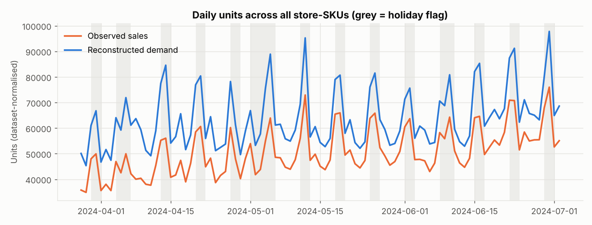
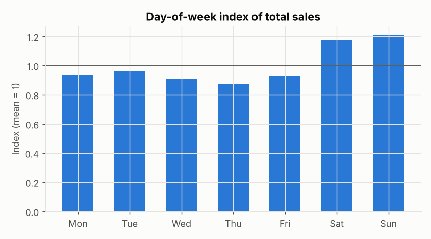
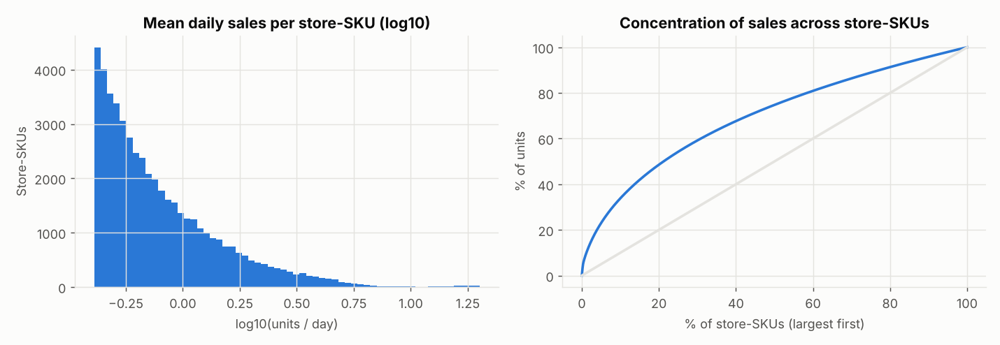
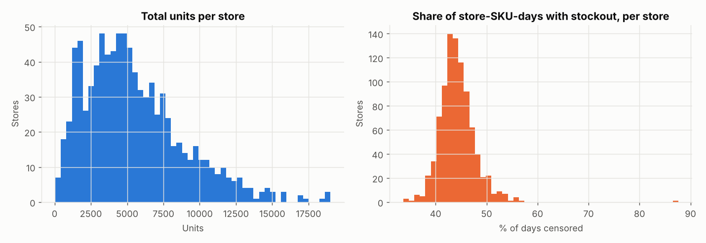
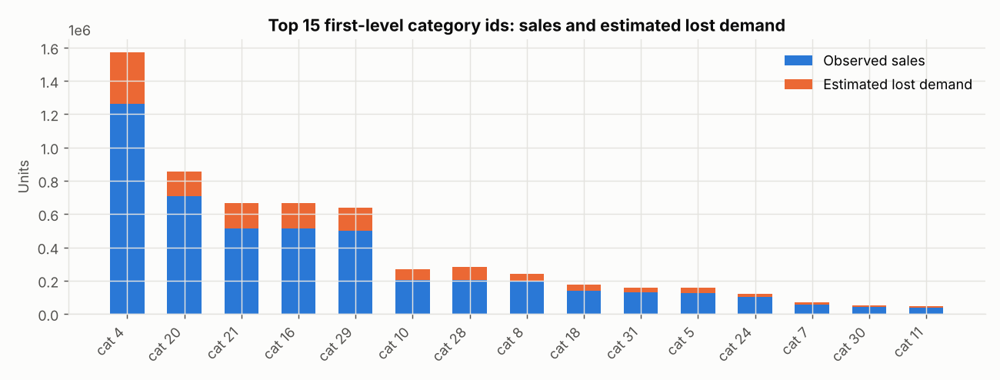
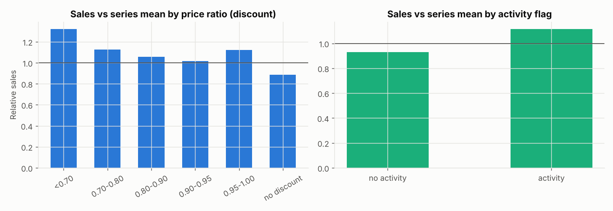
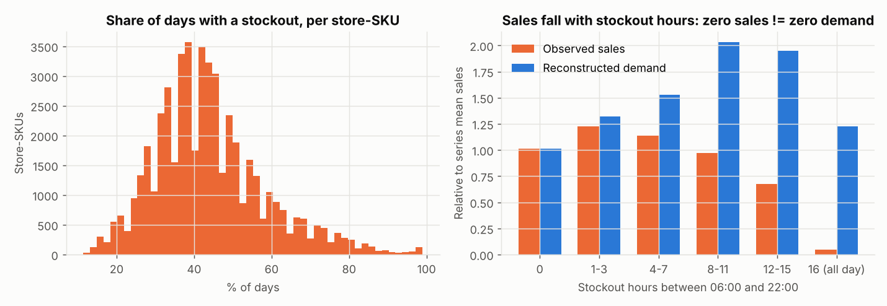
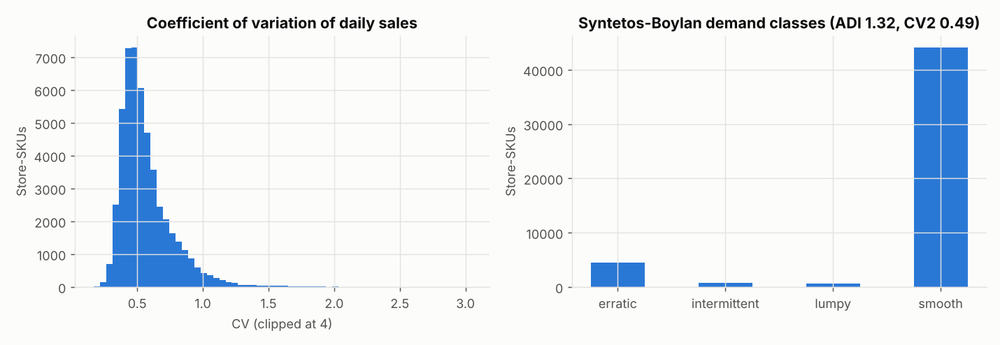
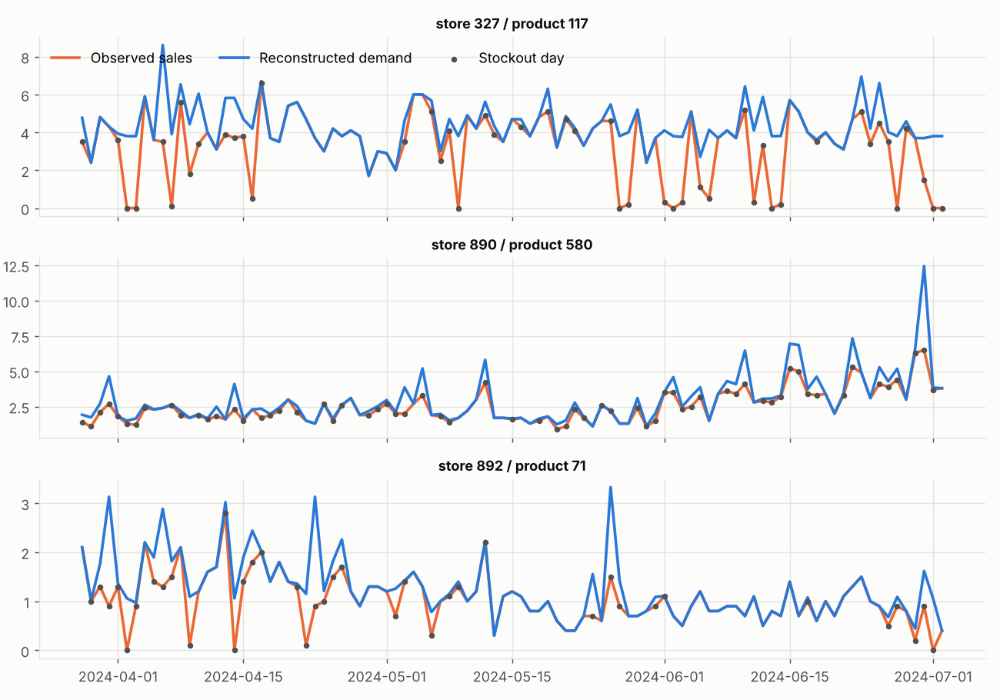

# Exploratory Data Analysis: FreshRetailNet-50K

Every figure and number here is generated by `freshguard eda`
(`src/freshguard/visualization/eda.py`). Raw statistics: `reports/metrics/freshretailnet/eda_stats.json`.
Data: 50,000 store-SKU series (898 stores, 865 products, 18 cities), 97 days
(2024-03-28 to 2024-07-02). Units are normalised by the publisher (0.1 granularity).

## 1. Sales and demand over time

* Total observed sales were 4.91M units; reconstructed demand is 6.19M, so an estimated
  **20.7% of demand went unserved** because of intraday stockouts.
* Sales grew strongly: the last week sold **50.3% more** than the first week. Late June
  demand rose faster than the models expected, which shows up later as a negative
  forecast bias on the test window.
* Pronounced weekly peaks. The dataset's `holiday_flag` marks weekends as well as public
  holidays: 82% of flagged days are Saturdays or Sundays. It therefore acts mainly as a weekend
  indicator.

**Business reading:** demand is growing and peaky, and the replenishment system has to
follow that growth. Ordering from last week's sales lags behind.

## 2. Weekly seasonality

Saturday (index 1.18) and Sunday (1.21) sell about 25-35% more than midweek
(Thursday is the lowest at 0.87). Weekend ordering must anticipate the peak one day ahead.

## 3. SKU-level distribution and concentration

* Median store-SKU sells 0.67 units/day; the 90th percentile sells 1.85 and the 99th 5.0.
  Most series are slow movers in normalised units.
* Concentration is moderate: the top 20% of store-SKUs carry **48.6%** of units, which is less
  extreme than a classic 80/20 pattern. Long-tail items matter for waste.

## 4. Store-level differences

Store volume varies 6.6x between the 10th and 90th percentile. The share of store-SKU-days with
a stockout ranges from **34% to 88%** across stores. Some stores are chronically understocked,
so their observed sales understate demand the most.

## 5. Category ids

32 first-level category ids. The top three account for 50.6% of units. Category ids are
anonymised, so **no category is labelled as fruit, vegetables, meat or bakery**. Results are
reported by id (`reports/metrics/freshretailnet/eda_category_summary.csv`).

## 6. Promotions

Relative to each series' mean, days with a price ratio below 0.70 sell 1.32x, and
undiscounted days sell 0.89x. Activity-flag days sell 1.12x against 0.93x without.
These are **descriptive associations**. Discounts are not randomised: they may target slow
or seasonal items, so this is not a causal promotion effect. Because the retailer plans
discounts and activities in advance, the target-day discount and activity flag are used as
known-in-advance features.

## 7. Censoring: zero sales are not zero demand

* **44.0% of store-SKU-days** have at least one out-of-stock opening hour, and 4.0% are out of
  stock all day. 19.8% of all opening hours are out of stock.
* 27.4% of series are censored on more than half of their days.
* Zero-sales days are rare (4.4% of days), but **76.4% of them are stockout days**. Treating
  zero sales as zero demand would be badly wrong here.
* Sales fall as stockout hours rise (0.67x the series mean with 12-15 stockout hours and 0.05x
  when out of stock all day), while reconstructed demand stays at or above normal levels.
  Days with 1-7 stockout hours have *above-average* sales (1.14-1.23x): stockouts happen on
  high-demand days. The reconstruction captures this (1.32-1.53x).
* Caveat: reconstructed demand on days with 8-15 stockout hours is about 2x the series mean.
  Part of this is the selection effect above, and part may be overestimation, which is why the
  simulation is repeated with observed sales and with a higher lost-demand estimate.

## 8. Volatility and intermittency

Median coefficient of variation of daily sales is 0.52. By the Syntetos-Boylan classes,
88.1% of series are *smooth*, 9.0% *erratic*, 1.6% *intermittent* and 1.2% *lumpy*. Fresh
front-warehouse demand is mostly regular, but noisy. Croston-type methods are therefore
benchmarks, not the main tool.

## 9. Example series

Three random high-volume, frequently censored series. Grey dots mark stockout days, where
reconstructed demand (blue) sits above observed sales (orange).

## Implications for modelling

1. Forecast **demand**, not sales: train on stockout-adjusted targets and evaluate on both
   reconstructed demand and uncensored days.
2. Use weekly seasonality, promotions and recent trend. A 90-day history cannot support
   yearly seasonality.
3. Stockout history is itself a signal: chronically understocked series need higher order-up-to
   levels.
4. Growth means stationary baselines will under-forecast; quantify bias, not just error.
