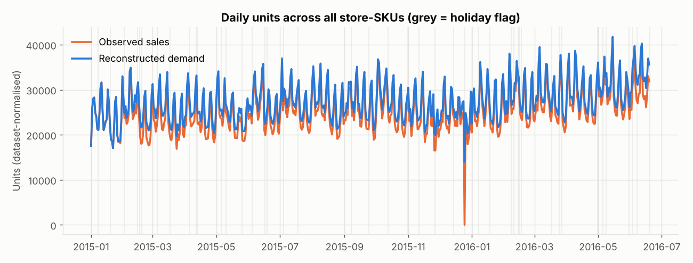
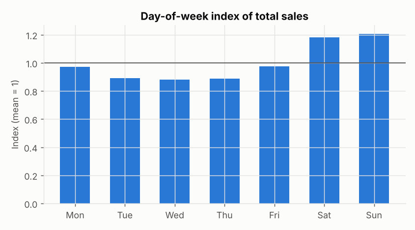
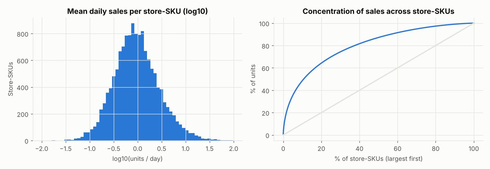
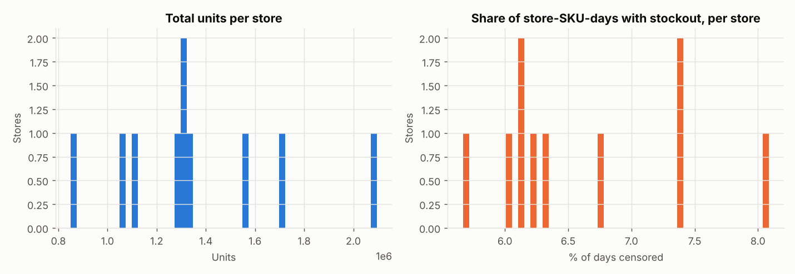
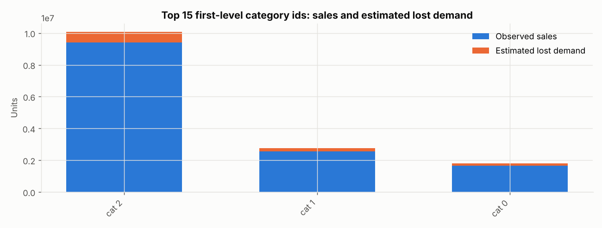
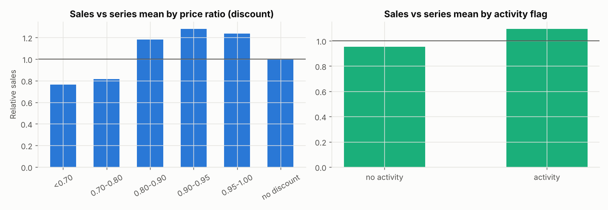
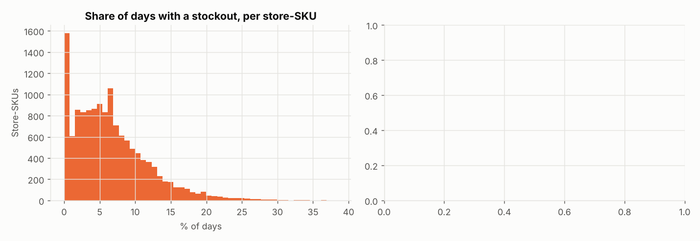
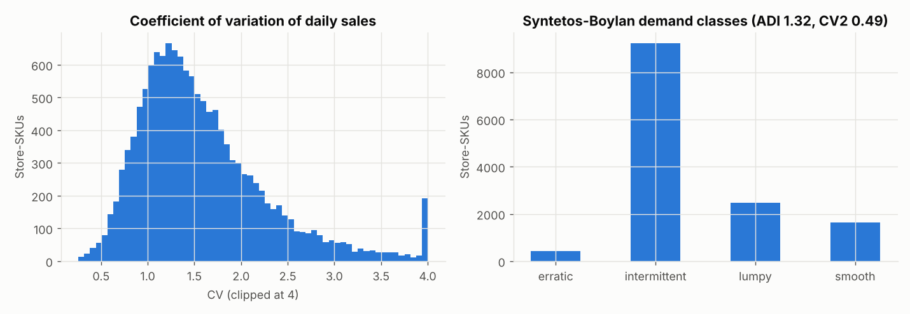
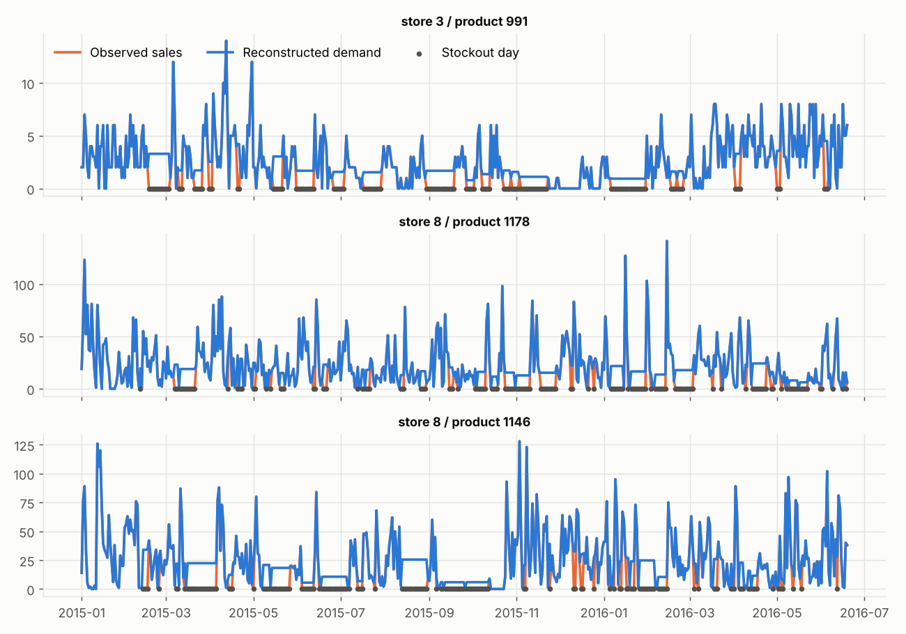

# Exploratory Data Analysis (m5)

All numbers below are computed by `freshguard eda` (`src/freshguard/visualization/eda.py`); raw values are in `reports/metrics/m5/eda_stats.json`.



















## Key statistics

```json
{
  "n_series": 13760,
  "n_days": 536,
  "date_range": [
    "2015-01-01",
    "2016-06-19"
  ],
  "total_sales": 13610938.0,
  "total_demand": 14638122.535271823,
  "lost_share_of_demand": 0.07017187708305717,
  "sales_growth_first_to_last_week_pct": 20.843085811985972,
  "weekday_index": {
    "Mon": 0.971,
    "Tue": 0.893,
    "Wed": 0.881,
    "Thu": 0.89,
    "Fri": 0.975,
    "Sat": 1.181,
    "Sun": 1.208
  },
  "holiday_flag_weekend_share": 0.3469387755102041,
  "holiday_vs_nonholiday_daily_sales_ratio": 0.9808598519206569,
  "share_units_top20pct_series": 0.6427571707401797,
  "mean_daily_sales_quantiles": {
    "0.1": 0.24813432835820895,
    "0.5": 0.9029850746268657,
    "0.9": 3.8457089552238823,
    "0.99": 15.648582089552237
  },
  "n_stores": 10,
  "store_units_p90_p10_ratio": 1.6633452657688685,
  "store_censored_share_range": [
    0.05667407642637874,
    0.08086346362072992
  ],
  "n_first_categories": 3,
  "top3_category_share_units": 1.0,
  "relative_sales_by_discount_bucket": {
    "<0.70": 0.765,
    "0.70-0.80": 0.814,
    "0.80-0.90": 1.182,
    "0.90-0.95": 1.282,
    "0.95-1.00": 1.236,
    "no discount": 0.995
  },
  "relative_sales_activity_vs_not": [
    0.952,
    1.096
  ],
  "corr_note": "descriptive association only: discounts may be targeted at slow or fast items, so this is not a causal promotion effect",
  "share_days_censored": 0.0660637582436654,
  "share_series_censored_over_half_days": 0.0,
  "share_zero_sales_days": 0.5172982742537313,
  "share_zero_sales_days_that_are_censored": 0.1277092183208436,
  "cv_median": 1.437308154202036,
  "demand_classes": {
    "erratic": 430,
    "intermittent": 9216,
    "lumpy": 2475,
    "smooth": 1639
  }
}
```
